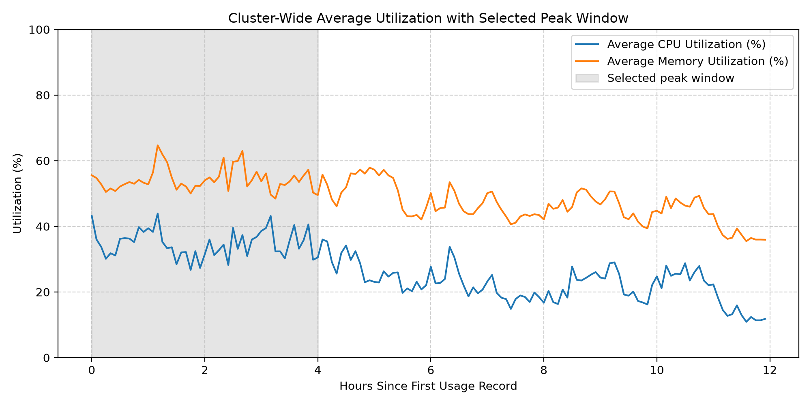

# os-2026-alibaba-trace

Operating Systems Final Project — **Topic 2: CPU and Memory Resource Analysis in Real Computing Systems**

---

## 1. Project Goal

We analyze per-machine CPU and memory utilization in the Alibaba Cluster Trace 2017 to study load variation during peak access, resource imbalance across machines, and how these observations relate to operating-system resource management. We distinguish machine-level OS behavior from cluster-scheduler decisions, and we do not treat high utilization as equivalent to poor user-perceived performance.

---

## 2. Dataset

- Dataset: Alibaba Cluster Trace 2017 (`cluster-trace-v2017`)
- Original source: https://github.com/alibaba/clusterdata
- Files used: `server_usage.csv` (per-machine resource utilization) and `server_event.csv` (machine list, used to cross-check the machine count)
- The data is **not included in this repository** (the files are large, and we link to the original source instead of redistributing them).

---

## 3. Data Access and Reproducibility

1. Download the trace from the original source above, following the `cluster-trace-v2017` instructions. The authors ask users to complete a short survey before the download link is provided.
2. Unpack the archive and place `server_usage.csv` (and `server_event.csv`) in a `data/` folder at the repository root. This folder is excluded by `.gitignore`.
3. Install dependencies and run:

```bash
pip install -r requirements.txt
jupyter notebook explore_week1.ipynb       # data exploration and cluster-wide trend
# Also run task1_quality_check.py (cells separated by "# %%") for the data-quality
# checks and peak-window selection.
```

---

## 4. Task 1 — Dataset Exploration

### 4.1 Schema Summary

`server_usage.csv` has no header row. We name the columns following the official schema order:

| Column | Meaning | Unit |
|---|---|---|
| `timestamp` | Sampling time | seconds (relative to the trace) |
| `machine_id` | Machine identifier | — |
| `util_cpu` | CPU utilization | % |
| `util_mem` | Memory utilization | % |
| `util_disk` | Disk utilization | % |
| `load1` / `load5` / `load15` | Load average over 1, 5, and 15 minutes | average number of runnable tasks |

### 4.2 Data-Quality Report

| Item | Result |
|---|---|
| Number of records | 187,963 |
| Number of machines | 1,310 (`server_event` lists 1,313) |
| Time coverage | 39,600–82,500 s, about 11.9 hours |
| Sampling interval | One record every 5 minutes, 144 time points |
| Missing records | 188,640 expected (1,310 × 144); 677 fewer found (about 0.36%) |
| Missing values | 1 record has empty `util_cpu`, `util_disk`, and `load1/5/15`; all other fields are complete |
| Value ranges | `util_cpu`, `util_mem`, and `util_disk` are all within 0–100%; no out-of-range values |

Summary statistics:

| Column | Mean | Min | Max |
|---|---|---|---|
| `util_cpu` (%) | 26.5 | 0.5 | 89.7 |
| `util_mem` (%) | 48.9 | 2.3 | 95.4 |
| `util_disk` (%) | 47.1 | 27.4 | 96.8 |
| `load1` | 18.5 | 0.0 | 132.1 |

Observations and open items:

- **Pattern of missing records:** The histogram (`week1_records_per_machine.png`) shows that most machines have the full 144 records, while a group of machines has 142. This may be the same two time points missing, but we have **not yet verified** it.
- **Three machines have no usage records:** `machine_id` 149, 602, and 930 appear in `server_event` but not in `server_usage`. The reason has not been determined.
- **`load1` reaches 132:** Whether this exceeds the machines' core count depends on the number of cores per machine, which we have not yet confirmed from this dataset.

### 4.3 Sample Records

Five example records from `server_usage.csv` (taken from the output of `explore_week1.ipynb`, unsorted):

| timestamp | machine_id | util_cpu | util_mem | util_disk | load1 | load5 | load15 |
|---|---|---|---|---|---|---|---|
| 41700 | 237 | 23.38 | 30.08 | 42.20 | 15.82 | 13.86 | 12.64 |
| 39600 | 265 | 26.36 | 29.54 | 57.60 | 17.46 | 18.90 | 16.70 |
| 42600 | 770 | 49.14 | 60.10 | 41.86 | 33.20 | 31.22 | 30.52 |
| 40800 | 776 | 33.24 | 47.52 | 43.60 | 21.84 | 22.10 | 24.02 |
| 42900 | 393 | 45.72 | 58.72 | 42.00 | 34.10 | 36.24 | 36.92 |

---

## 5. Peak Access Window

**Method:** We compute the cluster-wide mean CPU utilization at each time point, then slide a 4-hour window (48 sampling points) over the series and select the window with the highest mean CPU utilization.

**Result:** The highest-CPU 4-hour window is **hours 0–4**.

| | Inside window (0–4 h) | Outside window |
|---|---|---|
| Mean CPU utilization | 34.8% | 22.4% |
| Mean memory utilization | 54.4% | 46.3% |

Across the whole trace, the gap "memory utilization − CPU utilization" has a median of 22.4 percentage points, with the middle half of values between 20.1 and 25.0 and a full range of 6.5 to 34.3. Memory utilization stays above CPU utilization throughout.

**Limitation:** CPU utilization declines steadily from the start of the trace, so the highest-CPU window necessarily falls at the beginning. Hour 0 is the start of this dataset and earlier behavior is not observed, so the "peak" here is only a relative comparison within the available window, not necessarily the cluster's all-day peak.



---

## 6. Figures and Tables

| File | Content | Status |
|---|---|---|
| `week1_cluster_trend.png` | Cluster-wide average CPU and memory utilization over 12 hours | Done |
| `week1_peak_window.png` | Same, with the selected 4-hour peak window highlighted | Done |
| `week1_records_per_machine.png` | Distribution of record counts per machine | Done |

More figures for the CPU, memory, and imbalance analyses will be added as the project progresses.
| `week2_peak_resource_dist.png` | Distribution of per-machine mean CPU and memory utilization during peak hours (0–4 h) | Done |

**Preliminary Week 2 observations (`explore_week2.ipynb`):** During the 0–4 h peak window across all 1,310 machines, per-machine mean CPU utilization averages 34.8% (range 0.7%–55.3%) and exhibits a bimodal distribution, with a secondary cluster around 22–27% (~188 machines) and the main cluster between 28–50% (~1,094 machines). Per-machine mean memory utilization is noticeably higher at 54.4% (range 4.4%–90.2%) and likewise splits into two clusters (around 30–40% and 45–75%). Overall, memory appears to be the more heavily occupied resource across the cluster during peak hours, and the bimodal split raises the question of whether distinct hardware tiers or workload types exist across machines.
---

## 7. Research Questions (draft)

1. During the peak window, how much do CPU utilization variability and the fraction of time at high load differ across machines? Do persistently overloaded and persistently idle machines coexist?
2. Are CPU and memory utilization correlated across machines? What fraction of machines show a mismatch, i.e., high memory with low CPU, or high CPU with low memory?
3. Using low/medium/high utilization bands (thresholds to be defined and justified by us), how do the proportions of machines in each band shift before, during, and after the peak window?

Initial hypothesis: the cluster-wide mean CPU utilization is only about 26%, while individual records reach 89.7%. This may reflect a few highly loaded machines being averaged with many lightly loaded ones. **This is a hypothesis to be tested, not an established result.**

---

## 8. Progress

- [x] Week 1: data access, Task 1 exploration, peak-window selection
- [ ] Week 1: proposal and analysis plan
- [ ] Week 2: preliminary CPU and memory charts and code
- [ ] Week 3: imbalance analysis, OS interpretation, limitations
- [ ] Week 4: website, reproducibility test, presentation

## 9. Team

| Name | Responsibilities |
|---|---|
| | |
