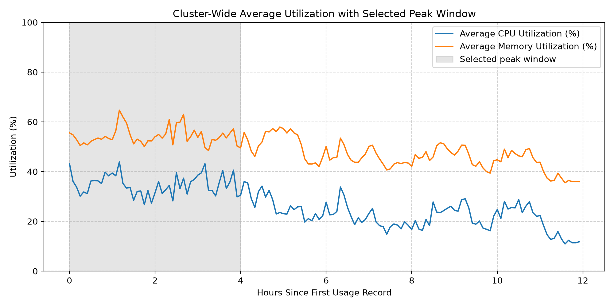

# os-2026-alibaba-trace

作業系統期末專題 — **Topic 2:CPU and Memory Resource Analysis in Real Computing Systems**

## 1. 專題目標

分析 Alibaba Cluster Trace 2017 中各機器的 CPU 與記憶體使用率,觀察尖峰期間的負載變化與機器之間的資源不平衡,並連結 OS 的資源管理概念。分析時會區分「單機 OS 層級行為」與「叢集排程器決策」,也不把高使用率等同於使用者體驗變差。

---

## 2. 資料來源

- 資料集:Alibaba Cluster Trace 2017(`cluster-trace-v2017`)
- 原始來源:https://github.com/alibaba/clusterdata
- 使用檔案:`server_usage.csv`(各機器的資源使用率)、`server_event.csv`(機器清單,用於比對機器數)
- 資料**不放在本 repo**(檔案大,且作業要求連結到原始來源,不重新散布)

---

## 3. 如何取得資料與重現

1. 到上面的原始來源,依 `cluster-trace-v2017` 的說明下載。官方要求先填一份簡短問卷才會提供下載連結。
2. 解壓縮後,把 `server_usage.csv`(以及 `server_event.csv`)放在 repo 根目錄的 `data/` 資料夾(已被 `.gitignore` 排除)。
3. 安裝套件並執行:

```bash
pip install -r requirements.txt
jupyter notebook explore_week1.ipynb       # 資料探索與全叢集趨勢
# 另外執行 task1_quality_check.py(以 # %% 分隔的 cell)完成資料品質檢查與尖峰視窗選擇
```

---

## 4. Task 1 — 資料探索(Dataset exploration)

### 4.1 Schema 摘要

`server_usage.csv` 沒有表頭,欄位依官方 schema 順序命名如下:

| 欄位 | 意義 | 單位 |
|---|---|---|
| `timestamp` | 取樣時間 | 秒(相對於 trace 起點) |
| `machine_id` | 機器編號 | — |
| `util_cpu` | CPU 使用率 | % |
| `util_mem` | 記憶體使用率 | % |
| `util_disk` | 磁碟使用率 | % |
| `load1` / `load5` / `load15` | 1、5、15 分鐘的 load average | 平均可執行工作數 |

### 4.2 資料品質報告

| 項目 | 結果 |
|---|---|
| 資料筆數 | 187,963 筆 |
| 機器數 | 1,310 台(`server_event` 記載 1,313 台) |
| 時間範圍 | 39,600–82,500 秒,約 11.9 小時 |
| 取樣間隔 | 每 5 分鐘一筆,共 144 個時間點 |
| 缺漏紀錄 | 預期 188,640 筆(1,310 × 144),實際少 677 筆(約 0.36%) |
| 缺失值 | 1 筆資料的 `util_cpu`、`util_disk`、`load1/5/15` 為空,其餘欄位無缺失 |
| 數值範圍 | `util_cpu`、`util_mem`、`util_disk` 都在 0–100% 內,沒有超出範圍的值 |

數值概況:

| 欄位 | 平均 | 最小 | 最大 |
|---|---|---|---|
| `util_cpu` (%) | 26.5 | 0.5 | 89.7 |
| `util_mem` (%) | 48.9 | 2.3 | 95.4 |
| `util_disk` (%) | 47.1 | 27.4 | 96.8 |
| `load1` | 18.5 | 0.0 | 132.1 |

觀察與待確認事項:

- **缺漏紀錄分布:** 從直方圖(`week1_records_per_machine.png`)看,多數機器有完整 144 筆,另有一群機器各少 2 筆(142 筆)。這可能是同樣兩個時間點缺漏,但**尚未驗證**。
- **3 台機器沒有使用紀錄:** `machine_id` 149、602、930 出現在 `server_event`,但 `server_usage` 沒有它們的資料,原因尚未查明。
- **`load1` 最高 132:** 是否代表超過核心數,要先確認每台機器的核心數,目前尚未在本資料中確認。

### 4.3 樣本資料

`server_usage.csv` 的 5 筆範例紀錄(來自 `explore_week1.ipynb` 輸出,未排序):

| timestamp | machine_id | util_cpu | util_mem | util_disk | load1 | load5 | load15 |
|---|---|---|---|---|---|---|---|
| 41700 | 237 | 23.38 | 30.08 | 42.20 | 15.82 | 13.86 | 12.64 |
| 39600 | 265 | 26.36 | 29.54 | 57.60 | 17.46 | 18.90 | 16.70 |
| 42600 | 770 | 49.14 | 60.10 | 41.86 | 33.20 | 31.22 | 30.52 |
| 40800 | 776 | 33.24 | 47.52 | 43.60 | 21.84 | 22.10 | 24.02 |
| 42900 | 393 | 45.72 | 58.72 | 42.00 | 34.10 | 36.24 | 36.92 |

---

## 5. 尖峰存取期間(Peak access window)的選擇

**方法:** 先計算每個時間點全叢集所有機器的平均 CPU 使用率,再用 4 小時(48 個取樣點)的滑動視窗,找出平均 CPU 最高的視窗。

**結果:** 平均 CPU 最高的 4 小時視窗是 **0–4 小時**。

| | 視窗內(0–4h) | 視窗外 |
|---|---|---|
| 平均 CPU 使用率 | 34.8% | 22.4% |
| 平均記憶體使用率 | 54.4% | 46.3% |

另外,全程「記憶體使用率 − CPU 使用率」的差距,中位數為 22.4 個百分點,中間一半的時間落在 20.1–25.0,全範圍 6.5–34.3。記憶體使用率在整個期間都高於 CPU。

**限制:** 圖上 CPU 從開頭一路下降,所以最高的視窗必然落在最前面。0 小時是這份資料的起點,看不到更早的狀況,因此「尖峰」只是這份資料窗口內的相對比較,不代表整個叢集全天的高峰。



---

## 6. 圖表清單

| 檔案 | 內容 | 狀態 |
|---|---|---|
| `week1_cluster_trend.png` | 全叢集平均 CPU / 記憶體使用率,12 小時 | 已完成 |
| `week1_peak_window.png` | 同上,標示選定的 4 小時尖峰視窗 | 已完成 |
| `week1_records_per_machine.png` | 每台機器的紀錄筆數分布 | 已完成 |

---

## 7. 研究問題(草案,待組員討論)

1. 尖峰期間,不同機器的 CPU 使用率波動與持續高負載比例差異多大?是否同時存在長期高負載與長期閒置的機器?
2. CPU 與記憶體使用率是否相關?有多少機器屬於「高記憶體低 CPU」或「高 CPU 低記憶體」?
3. 以低/中/高三個使用率區間(門檻須自訂並說明理由),尖峰前後各區間的機器比例如何轉移?

初步假設:全叢集平均 CPU 只有約 26%,但單筆最高到 89.7%,可能是少數高負載機器與多數低負載機器平均後互相抵銷。**這是待檢驗的假設,尚未證實。**

---

## 8. 進度

- [x] Week 1:資料取得、Task 1 資料探索、尖峰視窗選擇
- [ ] Week 1:提案與分析計畫
- [ ] Week 2:Task 2、Task 3 初步圖表與程式
- [ ] Week 3:Task 4、OS 概念解讀、限制說明
- [ ] Week 4:網站、重現性測試、簡報

## 9. 組員與分工

| 姓名 | 負責項目 |
|---|---|
| 【】 | 【】 |

